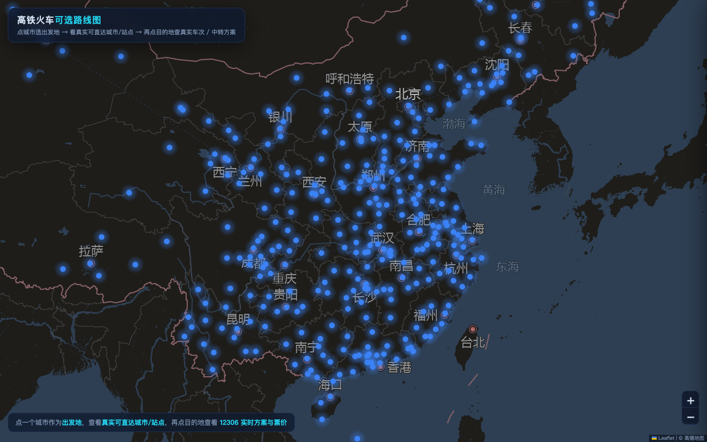

# 🚄 高铁火车可选路线图（railmap）

一个可交互的全国高铁/火车路线图 Web 应用：**点城市作为出发地，即可看到真实可直达的城市与站点**（按真实铁路走向绘制折线，不是直线连），再点目的地查看 **12306 实时车次、票价与官方换乘方案**。

数据规模：全国 **342 城市、3583 站、16623 趟车**的经停库。

## 功能特性

- 点城市看可直达站点：基于城市对直达矩阵，一图看清从出发地能坐火车直达哪些城市/站点
- 真实铁路走向：按车次经停站坐标绘制折线，看到列车实际怎么走
- 12306 实时数据：车次、时刻、余票、票价实时查询
- 官方换乘方案：无直达时给出中转方案（按时间 / 按价格两份排序）
- 免 key 地图底图：高德瓦片模板 `wprd0{1-4}.is.autonavi.com`（style=7），不配任何 key 也能显示地图

## 截图



深色主题地图，蓝点为车站；点击城市选择出发地后，高亮真实可直达的城市/站点；再点目的地弹出 12306 实时车次、票价与换乘面板。左上角有操作提示，右下角为缩放与版权信息。

## 快速开始

环境要求：Python 3.9+（Web 服务本身零第三方依赖，纯标准库）。

```bash
git clone https://github.com/YaoChunwang/railmap.git
cd railmap

# 1) 下载数据包（必须，约 38 MB）
git clone https://github.com/YaoChunwang/railmap-data.git data

# 2) 配置（可选，不配也能跑）
cp config.example.json config.json

# 3) 启动
python3 server.py
# 打开 http://127.0.0.1:8650/
```

**可选：12306 实时查询数据层**（查实时车次/票价/换乘需要；需 Python 3.10+）：

```bash
python3 -m venv venv
venv/bin/pip install mcp-server-12306   # https://github.com/drfccv/mcp-server-12306
```

未安装数据层时，地图、直达矩阵、缓存数据仍可正常使用，仅实时查询接口会提示错误。

## 配置（config.json）

项目根目录放一个 `config.json`（已被 `.gitignore` 忽略，不会提交）。从模板复制后按需修改：

```bash
cp config.example.json config.json
```

| 字段 | 默认值 | 说明 |
| --- | --- | --- |
| `port` | `8650` | Web 服务端口 |
| `amap_key` | `YOUR_AMAP_KEY` | 高德 Web 服务 key。**仅**用于补站名的地理编码脚本（`build_cities.py` / `fill_station_geo2.py`）；地图底图瓦片不需要 key |
| `data_dir` | `data` | 数据目录（相对路径按项目根目录解析） |
| `cache_dir` | `cache` | 查询结果缓存目录 |
| `mcp_python` | `venv/bin/python` | mcp_12306 数据层的 Python 解释器 |
| `maps_client` | 空 | 外部地理编码 CLI 路径，可选（`fill_station_geo.py` 用，不配则跳过该数据源） |

`amap_key` 也可以通过环境变量 `AMAP_API_KEY` 提供；占位符 `YOUR_AMAP_KEY` 视为未配置。

## 数据包获取

运行需要 `data/` 目录下的数据文件（车站坐标、经停库、直达矩阵、缓存等）。两种方式：

**方式一（推荐）：从数据仓库下载**

```bash
git clone https://github.com/YaoChunwang/railmap-data.git data
```

**方式二：自己重建**

```bash
python3 fetch_allroutes.py    # 全量抓车次经停库，约 12 小时，支持断点续跑
python3 build_cities.py       # 342 城市坐标
python3 build_matrix.py       # 城市对直达矩阵（建议挂每日凌晨定时任务重建）
```

> ⚠️ 抓取全程带限流退避（触发反爬后按 5→10→20→30 分钟指数退避封顶），请勿并发跑多个抓取任务，否则可能被 12306 封接口。

数据文件的详细说明见 [railmap-data 仓库](https://github.com/YaoChunwang/railmap-data)。

## 架构简述

```
railmap/
├── server.py            # 纯标准库 HTTP 服务（ThreadingHTTPServer + IPv6 双栈）
│                        #   GET /                -> static/index.html
│                        #   GET /api/query       -> 12306 实时车次查询
│                        #   GET /api/route       -> 车次真实经停折线
│                        #   GET /api/direct      -> 直达矩阵（A -> 各城直达信息）
│                        #   GET /api/transfer    -> 官方换乘方案
├── mcp12306.py          # 12306 数据层封装：stdio JSON-RPC 调 venv 里的
│                        #   mcp_12306（PyPI: mcp-server-12306），内置限流识别与全局退避
├── graph.py             # 经停库图结构、换乘路径搜索
├── build_matrix.py      # 城市对双向直达矩阵构建（可断点续跑）
├── build_cities.py      # 城市坐标构建（车站匹配 → 高德 → Nominatim 兜底）
├── fetch_allroutes.py   # 全量车次经停抓取（断点续跑、失败重试）
├── fill_station_geo*.py # 车站坐标补齐/修复（邻站校验，防同名异地站匹配错）
├── railconfig.py        # config.json 加载
├── config.example.json  # 配置模板
├── static/              # 前端（Leaflet，免 key 高德瓦片底图，API 走相对路径）
└── data/                # 数据包（来自 railmap-data 仓库，git 忽略）
```

数据流：`fetch_allroutes.py` 抓经停库 → `build_matrix.py` 汇总城市对直达信息 → `server.py` 运行期按需实时查询并写缓存（`cache/`、`pricecache.json` 等）→ 前端渲染真实走向与方案。

## 免责声明

- 本项目数据来自 **12306 公开接口**，仅供学习与自用研究，请勿滥用。
- 频繁请求可能触发 12306 反爬限制甚至封禁 IP，风险自负；本项目内置限流退避仅为降低风险。
- 车次、票价、余票、时刻等信息以 12306 官方实时数据为准；本项目不提供任何购票服务。
- 严禁商业用途。使用本项目造成的任何后果由使用者自行承担。

## License

[MIT](LICENSE)
